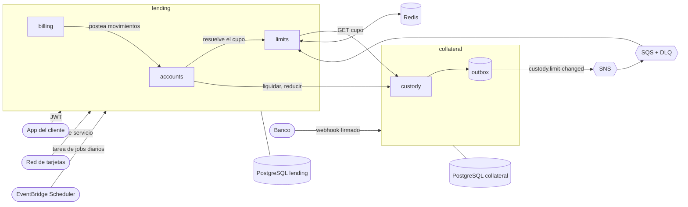

# Acme Credit: plataforma de tarjeta de crédito asegurada

Una tarjeta de crédito asegurada: el cliente deposita dinero como garantía, ese depósito define su cupo, gasta contra el cupo y paga. Al cerrar la cuenta la garantía se devuelve, o se aplica a lo que quede debiendo.

La plataforma son dos microservicios NestJS, cada uno con su propia base de datos PostgreSQL, más un conjunto pequeño de librerías compartidas.

| Servicio | Es dueño de | Qué hace |
| --- | --- | --- |
| `collateral` (puerto 3001) | El dinero retenido como garantía | Cuentas de custodia, depósitos confirmados por webhooks bancarios firmados, cálculo del cupo, liquidación (aplicar y liberar), reducciones de cupo y publicación de eventos con outbox |
| `lending` (puerto 3000) | La línea de crédito | Cuentas de tarjeta, autorización de compras, compras diferidas a cuotas, reversos, pagos, estados de cuenta, intereses, mora, cierre y cierre por impago |

Todo lo descrito aquí está cubierto por pruebas que corren contra PostgreSQL, Redis y LocalStack (SNS/SQS) reales. `pnpm check` las ejecuta todas.

## Contenido

1. [Requisitos](#requisitos)
2. [Levantar todo en local](#levantar-todo-en-local)
3. [LocalStack: qué simula y cómo inspeccionarlo](#localstack-qué-simula-y-cómo-inspeccionarlo)
4. [Variables de entorno](#variables-de-entorno)
5. [Probar la API a mano](#probar-la-api-a-mano)
6. [Cómo funciona](#cómo-funciona)
7. [Garantías para un servicio que mueve dinero](#garantías-para-un-servicio-que-mueve-dinero)
8. [Referencia de la API](#referencia-de-la-api)
9. [Pruebas](#pruebas)
10. [Despliegue en AWS](#despliegue-en-aws)
11. [Estructura del repositorio](#estructura-del-repositorio)
12. [Uso de IA](#uso-de-ia)
13. [Decisiones, límites y lo que falta](#decisiones-límites-y-lo-que-falta)
14. [Solución de problemas](#solución-de-problemas)

## Requisitos

- Node 22 y pnpm 10 (se activa con `corepack enable`; la versión exacta está fijada en `package.json`).
- Docker con Compose v2.
- Para ver LocalStack desde la terminal no hace falta instalar nada: se usa `awslocal` dentro del contenedor.

## Levantar todo en local

Hay dos formas. En ambas la infraestructura (PostgreSQL, Redis y LocalStack) corre en contenedores.

### Opción A: todo en contenedores

```bash
pnpm install
pnpm infra:up      # PostgreSQL, Redis y LocalStack; espera a que estén sanos
pnpm dev:setup     # genera llaves de desarrollo en .dev/ y los archivos services/*/.env
pnpm apps:up       # construye las imágenes, aplica las migraciones y arranca los dos servicios
pnpm demo          # recorre a un cliente desde el depósito hasta el cierre
```

Para detener: `pnpm apps:down` (conserva los datos) o `docker compose --profile apps down -v` (borra también los volúmenes).

### Opción B: servicios en tu máquina, infraestructura en contenedores

```bash
pnpm install
pnpm infra:up
pnpm dev:setup
pnpm build
pnpm --filter @acme/collateral prisma:migrate:deploy
pnpm --filter @acme/lending prisma:migrate:deploy
pnpm dev:collateral     # http://localhost:3001 (recarga al cambiar el código)
pnpm dev:lending        # http://localhost:3000
```

Los servicios leen `services/<servicio>/.env` (lo escribe `pnpm dev:setup` a partir de `.env.example`). Con esa configuración usan LocalStack para los eventos: collateral publica en SNS y lending consume de SQS.

### Qué hace `pnpm demo`

Contra los servicios en marcha (cualquiera de las dos opciones) ejecuta y muestra cada paso: abrir una cuenta de custodia, crear un depósito pendiente, confirmarlo con un webhook bancario firmado, pedir la tarjeta (el cupo sale del colateral), aprobar una compra, rechazar otra por exceder el disponible, hacer una compra diferida a 3 cuotas, pagar y cerrar la cuenta (el colateral se aplica a la deuda y el resto se libera).

### Comandos útiles

| Comando | Para qué |
| --- | --- |
| `pnpm infra:up` / `pnpm infra:down` | Levanta o baja PostgreSQL, Redis y LocalStack |
| `pnpm dev:setup` | Genera llaves de desarrollo en `.dev/` (ignorado por git) y los `.env` de los servicios. Es idempotente |
| `pnpm build` | Compila las librerías y los servicios (genera también el cliente Prisma) |
| `pnpm dev:lending`, `pnpm dev:collateral` | Arranca un servicio en modo desarrollo |
| `pnpm apps:up`, `pnpm apps:down`, `pnpm demo` | Servicios en contenedores y demostración |
| `pnpm token -- --sub=user-1` | Imprime un JWT de desarrollo (`--principal=service --scope="..."` para tokens de servicio) |
| `pnpm bank:confirm -- --reference=DEP-... --amount=100000` | Simula el webhook del banco (`--bank=hmac-bank` para el banco con HMAC) |
| `pnpm jobs:daily` | Ejecuta ahora los jobs diarios: cortes, estados de cuenta, mora y cierre por impago |
| `pnpm --filter @acme/lending prisma:migrate` | Crea una migración nueva en desarrollo (requiere `DATABASE_URL`) |
| `pnpm check` | Compila, hace lint y corre todas las pruebas |
| `pnpm prompts:export` | Regenera `PROMPTS.md` a partir de la transcripción de la sesión |

## LocalStack: qué simula y cómo inspeccionarlo

LocalStack simula SNS y SQS, que son los servicios de AWS que usa la mensajería entre los servicios. La imagen está fija en `localstack/localstack:4.9` porque las versiones recientes (`latest`) exigen un token de cuenta.

Al arrancar el contenedor, el script `docker/localstack/init.sh` crea:

| Recurso | Nombre | Detalle |
| --- | --- | --- |
| Tópico SNS | `custody-events` | Donde collateral publica `custody.limit-changed` |
| Cola SQS | `lending-limit-events` | Visibilidad de 30 s, redrive a la DLQ tras 5 recepciones |
| Cola SQS (DLQ) | `lending-limit-events-dlq` | Mensajes que lending no pudo procesar |
| Suscripción | tópico a cola | Entrega "raw", sin envoltorio de SNS |

El flujo es: un depósito se confirma en collateral, se escribe un evento en su tabla `outbox_events` en la misma transacción, un publicador lo envía a SNS, SNS lo entrega a la cola, y lending lo consume, vuelve a consultar el cupo a collateral, lo guarda en Redis y solo entonces borra el mensaje (ese es el ack).

Para inspeccionarlo:

```bash
docker compose exec localstack awslocal sns list-topics
docker compose exec localstack awslocal sqs list-queues
docker compose exec localstack awslocal sqs get-queue-attributes \
  --queue-url http://localhost:4566/000000000000/lending-limit-events \
  --attribute-names ApproximateNumberOfMessages ApproximateNumberOfMessagesNotVisible
docker compose exec localstack awslocal sqs receive-message \
  --queue-url http://localhost:4566/000000000000/lending-limit-events-dlq     # mensajes fallidos
docker compose exec redis redis-cli --scan --pattern 'limit:*'                 # cupos en caché
docker compose exec redis redis-cli HGETALL limit:<id-de-la-cuenta-de-custodia>
```

Para ver el evento en acción: haz un segundo depósito para una cuenta que ya tiene tarjeta (ver [Probar la API a mano](#probar-la-api-a-mano)) y consulta `GET /accounts/:id` en lending; el cupo sube en segundos sin que lending tenga que llamar a collateral en esa petición.

Si se cae el tópico o la cola, nada se pierde: el outbox de collateral reintenta con backoff exponencial, y si un evento se perdiera igualmente, el cupo en Redis caduca (12 horas) y se vuelve a consultar.

Los servicios hablan con LocalStack porque `AWS_ENDPOINT_URL` apunta a él; sin esa variable usan AWS real con las credenciales del entorno. Con `EVENT_BUS=memory` (valor para pruebas) usan un bus en memoria.

## Variables de entorno

`pnpm dev:setup` crea los `.env` a partir de los `.env.example` de cada servicio. Estas son las variables.

### Comunes a ambos servicios

| Variable | Significado |
| --- | --- |
| `PORT` | Puerto HTTP (3000 lending, 3001 collateral) |
| `DATABASE_URL` | Base de datos del servicio. En local, `postgresql://<servicio>:<servicio>@localhost:5432/<servicio>` |
| `AUTH_ISSUER`, `AUTH_AUDIENCE` | Emisor y audiencia esperados en los JWT |
| `AUTH_PUBLIC_KEY` o `AUTH_JWKS_URL` | Llave pública (PEM) o JWKS con que se verifican los JWT |
| `EVENT_BUS` | `sns` (collateral), `sqs` (lending) o `memory` |
| `AWS_ENDPOINT_URL`, `AWS_REGION` | Endpoint de LocalStack (omitirlo usa AWS real) y región |
| `TEST_DATABASE_URL`, `SHADOW_DATABASE_URL` | Solo desarrollo: base para pruebas y base sombra de Prisma |

### lending

| Variable | Valor por defecto | Significado |
| --- | --- | --- |
| `SERVICE_ID`, `SERVICE_PRIVATE_KEY` | `lending`, generada | Identidad y llave con que lending firma sus tokens de servicio hacia collateral |
| `CUSTODY_URL` | `http://localhost:3001` | Dónde está collateral |
| `REDIS_URL` | `redis://localhost:6379` | Caché compartida del cupo (sin ella usa memoria) |
| `LIMIT_EVENTS_QUEUE_URL` | cola `lending-limit-events` | Cola SQS de la que consume los cambios de cupo |
| `LIMIT_CACHE_TTL_SECONDS` | `43200` | Vigencia normal del cupo en Redis |
| `LIMIT_REQUEST_TIMEOUT_MS` | `200` | Tiempo máximo de la consulta a collateral |
| `LIMIT_UNAVAILABLE_POLICY` | `deny` | Si el cupo caducó y collateral no responde: `deny` rechaza la compra, `use_stale` usa el último cupo conocido |
| `LIMIT_STALE_MAX_AGE_SECONDS` | `3600` | Antigüedad máxima del último cupo bajo `use_stale` |
| `LIMIT_CAP_RELEASE_SECONDS` | `300` | Margen antes de retirar el tope tras reducir un cupo |
| `TERMS_APR_BPS` | `3600` | Tasa anual en puntos básicos (36%) |
| `TERMS_LATE_FEE` | `1500` | Cargo por mora, en centavos |
| `TERMS_MIN_PAYMENT_BPS`, `TERMS_MIN_PAYMENT_FLOOR` | `500`, `2500` | Pago mínimo: porcentaje (5%) y piso |
| `TERMS_DUE_DAYS` | `20` | Días entre el corte y el vencimiento |
| `TERMS_CHARGE_OFF_DAYS` | `90` | Días de mora para el cierre por impago |
| `TERMS_INSTALLMENT_OPTIONS` | `3:0,6:1800,12:2400` | Planes de cuotas como `meses:tasaAnualBps` |
| `TERMS_MIN_INSTALLMENT_PURCHASE` | `5000` | Monto mínimo para diferir una compra |

### collateral

| Variable | Valor por defecto | Significado |
| --- | --- | --- |
| `COLLATERAL_RATIO_BPS` | `9000` | Cupo = colateral retenido por este ratio (90%). Deja margen para intereses y cargos |
| `BANK_SIM_PUBLIC_KEY` | generada | Llave pública del banco simulado `sim-bank` (firma Ed25519) |
| `BANK_HMAC_SECRET` | generado | Secreto del banco `hmac-bank` (firma HMAC-SHA256) |
| `EVENTS_TOPIC_ARN` | tópico `custody-events` | Tópico SNS donde se publican los eventos |
| `OUTBOX_INTERVAL_MS` | `1000` | Cada cuánto el publicador vacía el outbox |

Todos los montos son enteros en la unidad menor (centavos). Las tasas se expresan en puntos básicos.

## Probar la API a mano

Los endpoints de cliente necesitan un JWT, los de servicio uno con scopes, y todo lo que mueve dinero un encabezado `Idempotency-Key`. En desarrollo los tokens se generan con `pnpm token`:

```bash
USER=$(pnpm -s token -- --sub=cliente-1)
NETWORK=$(pnpm -s token -- --sub=card-network --principal=service --scope=authorizations:write)

# 1. Cuenta de custodia y depósito
CUSTODY=$(curl -s -X POST localhost:3001/custody-accounts -H "Authorization: Bearer $USER" \
  -H "Idempotency-Key: $(uuidgen)" -H 'content-type: application/json' -d '{}' | jq -r .id)
REF=$(curl -s -X POST localhost:3001/custody-accounts/$CUSTODY/deposits -H "Authorization: Bearer $USER" \
  -H "Idempotency-Key: $(uuidgen)" -H 'content-type: application/json' \
  -d '{"bankId":"sim-bank","amount":100000}' | jq -r .reference)

# 2. El banco confirma el depósito (webhook firmado)
pnpm bank:confirm -- --reference=$REF --amount=100000

# 3. Tarjeta: el cupo sale del colateral (90 % de 100000 = 90000)
CARD=$(curl -s -X POST localhost:3000/cards -H "Authorization: Bearer $USER" \
  -H "Idempotency-Key: $(uuidgen)" -H 'content-type: application/json' \
  -d "{\"custodyAccountId\":\"$CUSTODY\",\"cycleDay\":15}" | jq -r .id)

# 4. La red de tarjetas autoriza compras (una normal y una diferida a 3 cuotas)
curl -s -X POST localhost:3000/accounts/$CARD/authorizations -H "Authorization: Bearer $NETWORK" \
  -H "Idempotency-Key: $(uuidgen)" -H 'content-type: application/json' -d '{"amount":40000}'
curl -s -X POST localhost:3000/accounts/$CARD/authorizations -H "Authorization: Bearer $NETWORK" \
  -H "Idempotency-Key: $(uuidgen)" -H 'content-type: application/json' -d '{"amount":12000,"installments":3}'

# 5. Consultar, pagar, ver movimientos y cerrar
curl -s localhost:3000/accounts/$CARD -H "Authorization: Bearer $USER" | jq
curl -s -X POST localhost:3000/accounts/$CARD/payments -H "Authorization: Bearer $USER" \
  -H "Idempotency-Key: $(uuidgen)" -H 'content-type: application/json' -d '{"amount":10000}'
curl -s localhost:3000/accounts/$CARD/movements -H "Authorization: Bearer $USER" | jq
curl -s -X POST localhost:3000/accounts/$CARD/closure -H "Authorization: Bearer $USER" -H "Idempotency-Key: $(uuidgen)"
```

Repetir una petición con la misma `Idempotency-Key` y el mismo cuerpo devuelve la misma respuesta sin repetir el efecto; con otro cuerpo devuelve `422`. Un token de otro cliente sobre la cuenta recibe `404`.

Para ver estados de cuenta, intereses y mora no hace falta esperar al mes: las pruebas avanzan un reloj simulado, y `pnpm jobs:daily` ejecuta los cortes que ya correspondan a la fecha real.

## Cómo funciona

### Arquitectura



### Por qué dos servicios

La invariante que más importa es "una compra nunca puede exceder el crédito disponible". Verificarla y aplicar la compra tiene que ser una sola transacción ACID sobre el saldo de la tarjeta, así que todo lo que cambia ese saldo (autorizaciones, reversos, pagos, intereses, cargos, cuotas) vive en un servicio. La garantía es distinta: tiene su propio ciclo de vida, sus propias integraciones con bancos, otro riesgo (custodia de dinero del cliente) y tolera consistencia eventual. Separar ahí es barato; separar en cualquier otro punto convertiría cada compra en una transacción distribuida. Además hace evolucionable el producto: lending ve el cupo como un valor externo, así que una tarjeta sin garantía solo necesita otra fuente de cupo.

El razonamiento completo, con las alternativas descartadas, está en [`docs/decisions.md`](docs/decisions.md) (en inglés). Los dominios, los flujos (diagramas de secuencia de cada flujo principal) y la seguridad están en [`docs/domains.md`](docs/domains.md), [`docs/flows.md`](docs/flows.md) y [`docs/security.md`](docs/security.md).

### Cómo se hablan los servicios

- Lending llama a collateral por HTTP con un token de servicio: leer el cupo, liquidar al cerrar y reducir un cupo. Esos comandos son idempotentes y un job los reintenta, así que no hay transacción distribuida ni nada que compensar.
- Collateral nunca llama a lending. Publica `custody.limit-changed` (solo el id de la cuenta y la versión) a través de un outbox transaccional hacia SNS; lending lo consume de una cola SQS con dead-letter queue y confirma el mensaje solo después de que Redis tiene el valor nuevo.
- El cupo se lee de una caché Redis compartida y se escribe con compare-and-set por versión, así que un evento duplicado o desordenado no puede dejar un valor viejo. Si la caché caducó y collateral no responde, una variable decide si se rechaza la compra (`deny`, por defecto) o se reutiliza el último cupo conocido durante un tiempo acotado (`use_stale`).

### Ciclo de vida de una tarjeta

1. **Custodia.** El cliente abre una cuenta de custodia y crea un depósito con un banco (queda `PENDING` con una referencia impredecible).
2. **Confirmación.** El banco avisa por webhook firmado. Collateral valida firma, ventana de tiempo, referencia, monto y moneda, acredita el depósito, recalcula el cupo (`retenido x ratio`) y publica el evento de cambio de cupo.
3. **Tarjeta.** El cliente pide la tarjeta eligiendo día de corte (1 o 15). Lending consulta el cupo, comprueba que la cuenta de custodia es suya y la activa. Una tarjeta solo existe si hay colateral confirmado.
4. **Uso.** La red de tarjetas autoriza compras, el cliente paga, cada mes se emite un estado de cuenta.
5. **Cierre.** El cliente cierra la cuenta, o se cierra sola por impago. El colateral se aplica a la deuda y el resto se libera.

### Mecánica de crédito

- **Cupo y disponible.** `cupo = colateral retenido x ratio` (90 % por defecto). `disponible = min(cupo, tope propio) - deuda`, donde la deuda suma capital, saldo diferido, intereses y cargos.
- **Compras y pagos.** Una compra es un débito sobre el capital. Un pago se aplica primero a cargos, luego a intereses y al final a capital, y restaura el disponible. Un pago mayor que lo adeudado se rechaza (no hay saldos a favor).
- **Estados de cuenta.** Cada tarjeta se corta el día 1 o 15 (elección del cliente). El estado de cuenta es inmutable y guarda saldo inicial, compras, pagos, reversos, intereses, cargos, cuotas, saldo final, pago mínimo, fecha de vencimiento y una copia de las condiciones aplicadas. Si el job no corrió algunos días, al ejecutarse emite todos los ciclos pendientes en orden.
- **Intereses.** Saldo diario promedio del capital durante el ciclo por la tasa anual, en enteros con redondeo half-even. No hay interés sobre interés ni sobre cargos.
- **Mora.** Si no se paga el pago mínimo antes del vencimiento se cobra un cargo único por estado de cuenta y la cuenta pasa a `DELINQUENT` (no puede comprar). Al pagar el mínimo vuelve a `ACTIVE`.
- **Cierre por impago.** Pasados `TERMS_CHARGE_OFF_DAYS` días de mora la cuenta se cierra sola y se aplica el colateral. Si no alcanza a cubrir la deuda, el faltante queda registrado.
- **Compras diferidas.** Una compra puede diferirse a 3, 6 o 12 meses (condiciones configurables, cada plan con su tasa). El monto completo cuenta contra el cupo desde el primer día, pero va a un bucket `DEFERRED`: no se puede pagar por adelantado ni genera interés revolvente. En el primer corte posterior a la compra se crea el plan con cuota fija (anualidad, en enteros; la última cuota absorbe el redondeo) y en cada corte se factura una cuota: baja el saldo diferido, sube el capital y sube el interés de la cuota. Lo facturado es deuda normal: aparece en el estado de cuenta, el pago mínimo nunca es menor que la cuota, puede caer en mora y genera interés revolvente si no se paga. Un reverso solo es posible antes de que el plan exista. Al cerrar la cuenta el plan se acelera y no se cobran intereses futuros.
- **Reducción de cupo.** El cliente puede bajar su cupo si la deuda cabe en el nuevo. Lending fija un tope propio en la misma transacción que valida la deuda, pide a collateral que libere el colateral sobrante, actualiza Redis y retira el tope pasado un margen de seguridad (ver la tabla de garantías).

Las condiciones (tasa, cargo, mínimo, días, planes de cuotas) las entrega un puerto con un adaptador estático (variables `TERMS_*`). Cada cuenta y cada estado de cuenta guardan la versión de las condiciones, para que un servicio de producto real las reemplace sin reescribir la historia.

## Garantías para un servicio que mueve dinero

| Preocupación | Qué se hizo | Dónde se comprueba |
| --- | --- | --- |
| Compras concurrentes sobre la misma tarjeta | `SELECT ... FOR UPDATE` sobre la fila de la cuenta dentro de una transacción corta; la consulta remota del cupo ocurre antes, nunca con el bloqueo tomado | 40 y 80 compras paralelas: número exacto de aprobadas y límite nunca excedido; prueba de propiedades sobre secuencias aleatorias |
| Representación del dinero | Enteros en unidades menores: `BIGINT` en la base, `bigint` en el dominio, validación de enteros seguros en la API, interés con enteros y redondeo half-even | Pruebas unitarias y restricciones de la base |
| Idempotencia | `Idempotency-Key` obligatoria en todo lo que mueve dinero; la fila de la clave se escribe en la misma transacción que el efecto; misma clave con otro cuerpo se rechaza; duplicados concurrentes se reducen a un efecto | Pruebas de repetición, reuso y concurrencia de 8 vías |
| Auditabilidad | Diario y bitácora de auditoría de solo inserción, forzado por triggers de la base; cada cambio de estado escribe una fila de auditoría con actor e id de correlación | Pruebas de triggers y de conciliación de estados de cuenta |
| Consistencia | Los saldos siempre igualan la suma del diario (pruebas y una restricción `CHECK` en cada estado de cuenta); los saldos negativos están prohibidos; índices únicos impiden doble reverso, doble interés y doble cargo por mora | Pruebas de propiedades y de conciliación |
| Falla de una dependencia | Outbox con backoff exponencial y `SKIP LOCKED`; SQS con redrive a una DLQ y alarmas; cierre y reducción de cupo reintentables; política de respaldo de la caché | Pruebas de outbox, SQS y cierre |
| Manipulación de depósitos | Webhooks firmados (Ed25519 o HMAC-SHA256 sobre marca de tiempo y cuerpo crudo), ventana anti-repetición, referencia impredecible por depósito, validación de monto y moneda, idempotencia por evento, intentos rechazados auditados | Pruebas de webhooks falsificados, vencidos, alterados y repetidos |
| Control de acceso | JWT firmados, propiedad por recurso (`404` para cuentas ajenas), scopes para principales de servicio | Pruebas de autenticación y propiedad |
| Un error que encontraron las pruebas | Una autorización que había leído el cupo anterior justo antes de una reducción podía aprobarse por encima del nuevo límite; ahora el tope de la reducción se mantiene un margen de seguridad | `closure.e2e-spec.ts` |

Además: logs en JSON en producción con id de correlación y actor, sin tokens, encabezados ni cuerpos; encabezados de seguridad (helmet); `GET /health` (vivo) y `GET /health/ready` (comprueba la base de datos).

## Referencia de la API

Los montos son enteros en la unidad menor. Todos los endpoints que modifican datos exigen el encabezado `Idempotency-Key`.

### collateral (puerto 3001)

| Endpoint | Quién lo llama |
| --- | --- |
| `POST /custody-accounts`, `GET /custody-accounts/:id`, `POST /custody-accounts/:id/deposits` | cliente |
| `POST /webhooks/banks/:bankId` (`sim-bank` con Ed25519, `hmac-bank` con HMAC) | banco, firmado |
| `GET /custody-accounts/:id/limit` | lending (`custody:read`) |
| `POST /custody-accounts/:id/settlements`, `POST /custody-accounts/:id/limit-reductions` | lending (`custody:settle`) |

### lending (puerto 3000)

| Endpoint | Quién lo llama |
| --- | --- |
| `POST /cards`, `GET /accounts/:id`, `GET /accounts/:id/movements`, `GET /accounts/:id/statements[/:n]`, `GET /accounts/:id/installment-plans` | cliente |
| `POST /accounts/:id/payments`, `POST /accounts/:id/closure`, `POST /accounts/:id/limit-reduction` | cliente |
| `POST /accounts/:id/authorizations` (con `installments` opcional), `POST /accounts/:id/authorizations/:authId/reversals` | red de tarjetas (`authorizations:write`) |
| `POST /internal/jobs/daily` | scheduler (`jobs:run`) |

Una autorización rechazada responde `200` con `status: DECLINED` y el motivo; una aprobada, `201`. Si el cupo no se puede determinar (caché caducada, collateral caído y política `deny`) responde `503 LIMIT_UNAVAILABLE`.

### Autenticación en desarrollo

Los servicios solo verifican JWT firmados; no gestionan usuarios. En desarrollo, `pnpm dev:setup` genera un par de llaves Ed25519 y `pnpm token` firma tokens con la privada. Los tokens de usuario llevan `principal=user`; los de servicio, `principal=service` y una lista de scopes. En producción se apunta `AUTH_JWKS_URL` al proveedor de identidad real.

## Pruebas

```bash
pnpm infra:up     # las pruebas de integración lo necesitan
pnpm check        # compila, lint, pruebas unitarias, de integración y end-to-end
```

Son 128 pruebas:

- **Unitarias:** dinero, redondeo, fechas, anualidades de cuotas, autenticación, cachés, bus en memoria y log de acceso.
- **Integración** (PostgreSQL, Redis y LocalStack reales): entrega de SNS a SQS, reentrega y dead-lettering; compare-and-set en Redis.
- **E2E por servicio:** cada endpoint, fallos de autorización, validación, idempotencia, propiedad, concurrencia, garantías de la base (triggers, restricciones), facturación sobre tiempo simulado (cortes, intereses, ciclos omitidos, cargos por mora, recuperación, cierre por impago), compras diferidas completas, cierre y reducción con una dependencia caída, outbox con fallas y bancos con ambos esquemas de firma.
- **Propiedades:** secuencias aleatorias de compras, compras diferidas, pagos y reversos mantienen la deuda dentro del cupo y el diario igual a los saldos.
- **E2E entre servicios** (`e2e/`): las dos aplicaciones reales, HTTP real, webhooks firmados, SNS/SQS y Redis, desde el depósito hasta el cierre.

Las pruebas de cada servicio usan bases separadas (`lending_test`, `collateral_test`) que el script de inicio de PostgreSQL ya crea, y aplican las migraciones solas.

## Despliegue en AWS

La infraestructura como código está en [`terraform/`](terraform/) (validada con `terraform validate`, nunca aplicada a una cuenta real). Construye por entorno: una VPC con subredes privadas y endpoints, repositorios ECR, un clúster ECS Fargate, un servicio por aplicación detrás de un ALB público (con WAF y límite de tasa; los endpoints internos siguen exigiendo tokens de servicio) y un ALB interno para las llamadas entre servicios, una instancia RDS PostgreSQL cifrada (con soporte Multi-AZ) por servicio, ElastiCache Redis con TLS y autenticación, el tópico SNS, la cola SQS y su DLQ con alarmas, entradas de Secrets Manager y una regla de EventBridge Scheduler que ejecuta los jobs diarios como una tarea Fargate.

Esquema del pipeline: construir `docker/service.Dockerfile` para cada servicio (target `runtime` para el servicio y target `migrate` etiquetado `<tag>-migrate`), subir a ECR, ejecutar la tarea de migración y actualizar el servicio. ECS usa interruptor de despliegue con reversión automática. Los secretos (URLs de base de datos y Redis, llaves) se inyectan desde Secrets Manager y nunca van en las imágenes.

```bash
cd terraform/environments/dev
terraform init -backend-config="bucket=<bucket-de-estado>" -backend-config="region=us-east-1"
terraform plan -var image_tag=<tag>
```

## Estructura del repositorio

```
services/lending      accounts, billing, limits (+ esquema Prisma, migraciones y pruebas)
services/collateral   custody (+ esquema Prisma, migraciones y pruebas)
lib/                  contracts, auth, cache, messaging, nest-common (solo código técnico)
e2e/                  prueba end-to-end entre los dos servicios
docker/               Dockerfile de los servicios, scripts de inicio de PostgreSQL y LocalStack
terraform/            módulos y entorno dev
scripts/              preparación de desarrollo, tokens, simulador de banco, demo, jobs diarios
docs/                 dominios, flujos (diagramas de secuencia), seguridad y decisiones
```

Cada servicio organiza su código por subdominio en `src/modules/`; los clientes de sistemas externos (collateral, bancos, condiciones) viven en `src/clients/` detrás de puertos con adaptadores, y los que son comunes a los dos servicios (mensajería, caché, autenticación) en `lib/`.

## Uso de IA

El diseño lo dirigí yo y se implementó con Claude Code: decidí la arquitectura, las fronteras y los compromisos en una conversación (incluyendo rechazar varias de las primeras propuestas del asistente) y delegué la implementación, las pruebas y la documentación bajo esas restricciones. El intercambio completo, en orden, está en [`PROMPTS.md`](PROMPTS.md).

## Decisiones, límites y lo que falta

- Los bancos están simulados (un adaptador Ed25519 y uno HMAC). El proveedor de identidad y el emisor de tokens de servicio se asumen, no se construyen: en local los firma una llave de desarrollo.
- Las condiciones del producto son un adaptador estático; las versiones por cuenta y por estado de cuenta permiten reemplazarlo.
- Las fechas de interés y corte usan UTC; no se modelan zonas horarias por producto.
- Una compra que ya se pagó no se puede reversar (no hay saldos a favor ni devoluciones).
- No hay pago anticipado de cuotas diferidas.
- La infraestructura de Terraform está validada pero no se ha aplicado en una cuenta de AWS.
- Pendientes razonables: congelar tarjeta, reducciones de cupo forzadas desde custodia, conciliación diaria de depósitos contra el estado de cuenta del banco, rate limiting por aplicación y revocación de tokens.

## Solución de problemas

- **LocalStack se cierra con "License activation failed".** Estás usando una imagen reciente. El `docker-compose.yml` fija `localstack/localstack:4.9`, que no pide token.
- **Los puertos 5432, 6379 o 4566 están ocupados.** Cambia los puertos con `POSTGRES_PORT`, `REDIS_PORT` o `LOCALSTACK_PORT` (y las URLs correspondientes en los `.env`).
- **Un cambio de `init.sql` no se aplica.** Esos scripts solo corren con el volumen vacío: `docker compose down -v` y vuelve a `pnpm infra:up`.
- **Prisma dice `P3009` o que una migración falló en la base de pruebas.** Reinicia solo esa base: `docker compose exec postgres psql -U lending -d lending_test -c "DROP SCHEMA public CASCADE; CREATE SCHEMA public;"` (igual con `collateral`).
- **Las pruebas fallan con "Cannot find module" o tipos faltantes en las librerías.** Los servicios consumen las librerías compiladas: ejecuta `pnpm build` antes.
- **`401` en todas las llamadas.** Los `.env` y los tokens tienen que salir de la misma ejecución de `pnpm dev:setup`; si regeneraste `.dev/`, reinicia los servicios.
