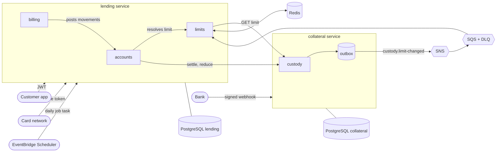

# Acme Credit: secured credit card lending platform

A secured credit card: the customer deposits money as a guarantee, the deposit sets the credit limit, the customer spends against that limit and repays. When the account is closed the guarantee is released, or applied to whatever is still owed.

The platform is two NestJS microservices, each with its own PostgreSQL database, plus a small set of shared libraries.

| Service | Owns | Main capabilities |
| --- | --- | --- |
| `collateral` | The money held as a guarantee | Custody accounts, bank deposits confirmed through signed webhooks, limit (cupo) calculation, settlement (apply/release) and limit reductions, outbox events |
| `lending` | The credit line | Card accounts, purchase authorizations, reversals, payments, statements, interest, late fees, delinquency, closure, charge-off |

Everything below was exercised by tests that run against real PostgreSQL, Redis and LocalStack (SNS/SQS). `pnpm check` runs them all.

## Contents

1. [Run it](#run-it)
2. [Architecture](#architecture)
3. [What makes it safe for money](#what-makes-it-safe-for-money)
4. [Credit mechanics](#credit-mechanics)
5. [API overview](#api-overview)
6. [Testing](#testing)
7. [Deploying to AWS](#deploying-to-aws)
8. [Repository layout](#repository-layout)
9. [How AI was used](#how-ai-was-used)
10. [Trade-offs and what is not done](#trade-offs-and-what-is-not-done)

## Run it

Requirements: Node 22, pnpm 10 (via corepack), Docker.

**Everything in containers**

```bash
pnpm install
pnpm infra:up        # PostgreSQL, Redis, LocalStack (SNS/SQS)
pnpm dev:setup       # generates dev keys under .dev/ and services/*/.env
pnpm apps:up         # builds the images, runs migrations, starts both services
pnpm demo            # walks a customer from deposit to closure against the running stack
```

`pnpm demo` prints every step: open a custody account, create a deposit, confirm it with a signed bank webhook, request a card, approve and decline purchases, pay, close the account (collateral applied to the debt, the rest released).

**Services on the host, infrastructure in containers**

```bash
pnpm install && pnpm infra:up && pnpm dev:setup && pnpm build
pnpm --filter @acme/collateral prisma:migrate:deploy
pnpm --filter @acme/lending prisma:migrate:deploy
pnpm dev:collateral        # http://localhost:3001
pnpm dev:lending           # http://localhost:3000
```

Useful helpers: `pnpm token -- --sub=user-1` (mint a dev JWT), `pnpm bank:confirm -- --reference=DEP-... --amount=100000` (simulate the bank webhook), `pnpm jobs:daily` (run statements, late fees and charge-off now).

LocalStack is pinned to `4.9`: newer images require an account token.

## Architecture



### Why two services

The invariant that matters most is "a purchase can never exceed the available credit". Checking it and applying the purchase must be one ACID transaction over the card balance, so everything that changes that balance (authorizations, reversals, payments, interest, fees) lives in one service. The guarantee is different: it has its own lifecycle, its own integrations with banks, a different risk (custody of customer money) and it tolerates eventual consistency. Splitting there is cheap; splitting anywhere else would turn every purchase into a distributed transaction. It also makes the product evolvable: lending sees the limit as an external value, so an unsecured card only needs a different limit source.

The full reasoning, with the alternatives that were rejected, is in [`docs/decisions.md`](docs/decisions.md). Domains, flows and security are described in [`docs/domains.md`](docs/domains.md), [`docs/flows.md`](docs/flows.md) (sequence diagrams for every main flow) and [`docs/security.md`](docs/security.md).

### Service interaction

- Lending calls collateral over HTTP with a service token: read the limit, settle on closure, reduce a limit. These commands are idempotent and retried by a job, so there is no distributed transaction and nothing to compensate.
- Collateral never calls lending. It publishes `custody.limit-changed` through a transactional outbox to SNS; lending consumes it from an SQS queue with a dead-letter queue and acknowledges only after Redis holds the new value.
- The limit is read from a shared Redis cache with versioned compare-and-set writes. If the cache has expired and collateral is unreachable, a configuration switch decides whether to decline (`deny`, default) or reuse the last known limit for a bounded time (`use_stale`).

## What makes it safe for money

| Concern | What was done | Where it is verified |
| --- | --- | --- |
| Concurrent purchases on one card | `SELECT ... FOR UPDATE` on the account row inside one short transaction; the remote limit lookup happens before it | 40 and 80 parallel purchases: exact number approved, limit never exceeded; property test over random sequences |
| Money representation | Integer minor units: `BIGINT` in the database, `bigint` in domain code, safe-integer validation at the API, round-half-even integer interest | unit tests, DB constraints |
| Idempotency | `Idempotency-Key` required on every money-moving call; key row written in the same transaction as the effect; same key with another body is rejected; concurrent duplicates collapse to one effect | replay, reuse and 8-way concurrency tests |
| Auditability | Append-only journal and audit log enforced by database triggers; every state change writes an audit row with actor and correlation id | trigger tests, statement reconciliation |
| Consistency | Balances equal the journal (checked in tests and by a `CHECK` identity on every statement); `CHECK` constraints forbid negative balances; unique indexes forbid double reversal, double interest and double late fee | property and reconciliation tests |
| Failure of a dependency | Outbox with exponential backoff and `SKIP LOCKED`; SQS redrive to a DLQ with alarms; retryable closure and limit reduction; cache fallback policy | outbox, SQS and closure tests |
| Tampering with deposits | Signed bank webhooks (Ed25519 over timestamp and raw body), replay window, unguessable per-deposit reference, amount and currency checks, per-event idempotency, rejected attempts are audited | forged, stale, tampered and replayed webhook tests |
| Access control | Signed JWTs, per-resource ownership (`404` for other people's accounts), scopes for service principals | auth and ownership tests |
| A bug found by the tests | An authorization that read the old limit just before a reduction could be approved above the new limit; the reduction cap is now held for a safety margin | `closure.e2e-spec.ts` |

## Credit mechanics

- **Limit.** `limit = held collateral * ratio` (90% by default, leaving room for interest and fees). Available credit is `min(limit, own cap) - debt`.
- **Purchases and payments.** A purchase is a debit on principal. A payment is applied to fees, then interest, then principal and restores available credit. Payments larger than the debt are rejected.
- **Statements.** Each card is cut on day 1 or 15 (customer's choice). A statement is immutable and records opening balance, purchases, payments, reversals, interest, fees, closing balance, minimum payment, due date and a snapshot of the terms applied.
- **Interest.** Average daily balance of principal over the cycle times the APR; no interest on interest or fees.
- **Late fees and delinquency.** If the minimum is not paid by the due date, one late fee is charged and the account becomes `DELINQUENT` (no purchases). Paying the minimum returns it to `ACTIVE`.
- **Closure.** A customer closes the account, or it is charged off after N days past due. Collateral is applied to the debt and the remainder is released; a shortfall is recorded.
- **Limit reduction.** The customer can lower the limit if the debt fits under the new one; the freed collateral is released.

Terms (APR, fee, minimum payment, charge-off days, cut days) come from a port with a static adapter today; each account and each statement stores the terms version so a product service can take over without rewriting history.

## API overview

All money amounts are integers in minor units (cents). All mutating endpoints below require an `Idempotency-Key` header.

**collateral** (`:3001`)

| Endpoint | Caller |
| --- | --- |
| `POST /custody-accounts`, `GET /custody-accounts/:id`, `POST /custody-accounts/:id/deposits` | customer |
| `POST /webhooks/banks/:bankId` | bank (signed) |
| `GET /custody-accounts/:id/limit` | lending (`custody:read`) |
| `POST /custody-accounts/:id/settlements`, `POST /custody-accounts/:id/limit-reductions` | lending (`custody:settle`) |

**lending** (`:3000`)

| Endpoint | Caller |
| --- | --- |
| `POST /cards`, `GET /accounts/:id`, `GET /accounts/:id/movements`, `GET /accounts/:id/statements[/:n]` | customer |
| `POST /accounts/:id/payments`, `POST /accounts/:id/closure`, `POST /accounts/:id/limit-reduction` | customer |
| `POST /accounts/:id/authorizations`, `POST /accounts/:id/authorizations/:authId/reversals` | card network (`authorizations:write`) |
| `POST /internal/jobs/daily` | scheduler (`jobs:run`) |

Both services expose `GET /health` (liveness) and `GET /health/ready` (database check). Logs are JSON in production with a correlation id and actor, and never contain tokens, headers or bodies.

## Testing

```bash
pnpm infra:up      # needed by the integration tests
pnpm check         # build, lint, unit, integration and end-to-end tests
```

- Unit: money, rounding, dates, auth, caches, in-memory bus, access log.
- Integration (real PostgreSQL, Redis, LocalStack): SNS to SQS delivery, redelivery and dead-lettering; Redis compare-and-set.
- Service e2e: every endpoint, authorization failures, validation, idempotency, ownership, concurrency, database guarantees (triggers, constraints), billing over simulated time (cuts, interest, missed cycles, late fees, cure, charge-off), closure and reduction with a failing dependency.
- Property test: random sequences of purchases, payments and reversals keep debt within the limit and the journal equal to the balances.
- Cross-service e2e: both real applications, real HTTP, signed webhooks, SNS/SQS and Redis, from deposit to closure.

## Deploying to AWS

Infrastructure as code lives in [`terraform/`](terraform/) (validated with `terraform validate`, not applied). It builds, per environment: a VPC with private subnets and endpoints, ECR repositories, an ECS Fargate cluster, one service per application behind a public ALB (with WAF and rate limiting; the internal endpoints still require service tokens) and an internal ALB for service-to-service calls, one encrypted Multi-AZ-capable RDS PostgreSQL instance per service, ElastiCache Redis with TLS and auth, the SNS topic, SQS queue and DLQ with alarms, Secrets Manager entries, and an EventBridge Scheduler rule that runs the daily jobs as a Fargate task.

Pipeline outline: build `docker/service.Dockerfile` for each service (`runtime` target for the service, `migrate` target tagged `<tag>-migrate`), push to ECR, run the migration task, then update the service. ECS uses a deployment circuit breaker with automatic rollback. Secrets (database URLs, Redis URL, keys) are injected from Secrets Manager, never baked into images.

## Repository layout

```
services/lending      accounts, billing, limits (+ prisma schema, migrations, tests)
services/collateral   custody (+ prisma schema, migrations, tests)
lib/                  contracts, auth, cache, messaging, nest-common (technical code only)
e2e/                  cross-service end-to-end test
docker/               service Dockerfile, PostgreSQL and LocalStack init scripts
terraform/            modules and the dev environment
scripts/              dev setup, tokens, bank simulator, demo, daily jobs
docs/                 domains, flows (sequence diagrams), security, decisions
```

## How AI was used

The design was driven by me and implemented with Claude Code: I decided the architecture, boundaries and trade-offs in conversation (including rejecting several of the assistant's first proposals), and delegated implementation, tests and documentation under those constraints. The complete exchange, in order, is in [`PROMPTS.md`](PROMPTS.md).

## Trade-offs and what is not done

- Installments (deferred purchases) are designed ([`docs/decisions.md`](docs/decisions.md)) but not implemented.
- Banks are simulated (one Ed25519 and one HMAC adapter). The identity provider and the service-token issuer are assumed, not built.
- The terms service is a static adapter.
- Interest dates use UTC; time zones per product are not modelled.
- A purchase that was already paid cannot be reversed (there are no credit balances or refunds).
- The infrastructure code has been validated but never applied to an AWS account.
