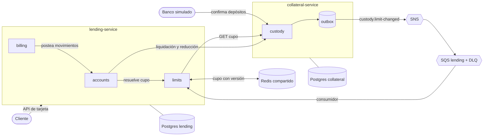
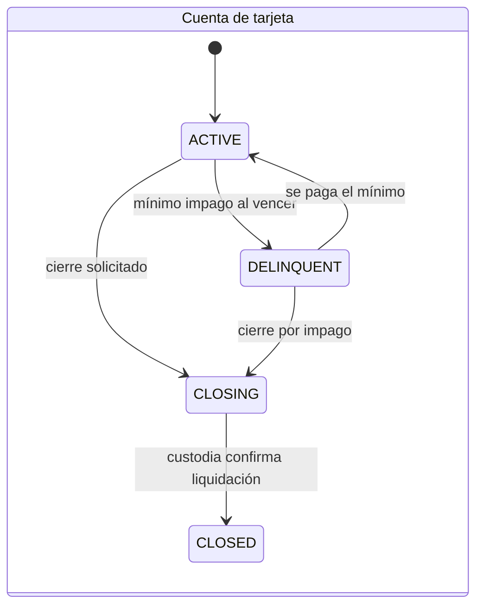
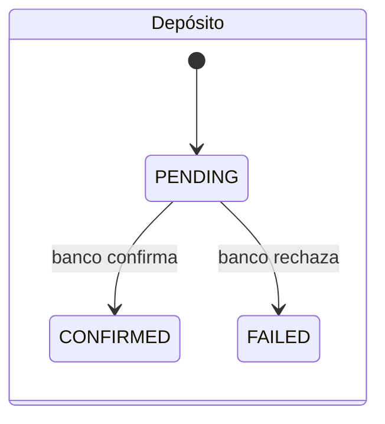

# Dominios

Dos servicios con base de datos propia. Lending consulta y ordena a custodia por HTTP. Custodia le avisa a lending de los cambios de cupo por eventos (SNS y SQS). Ambos usan puertos en `src/clients/` para que el proveedor concreto se pueda cambiar sin tocar el dominio.

## collateral-service

Dueño del dinero del cliente retenido como garantía. Define el cupo que ese dinero respalda; el ratio vive aquí.

| Módulo | Responsabilidad |
| --- | --- |
| custody | Cuenta de custodia, depósitos (`PENDING`, `CONFIRMED`, `FAILED`), diario de movimientos (`DEPOSIT`, `RELEASE`, `APPLIED`), cálculo del cupo (retenido por el ratio) con su versión, ejecución de liquidaciones y reducciones ordenadas por lending |
| health | Healthcheck |

Transversal: `shared/` (outbox, idempotencia, auditoría), `clients/messaging` y `clients/banks`.

API: abrir cuenta, depositar (elige banco), recibir el webhook de confirmación de cada banco (`POST /webhooks/banks/:bankId`), consultar cupo `{ cupo, version }`, ejecutar liquidación, ejecutar reducción de cupo.

Evento que publica: `custody.limit-changed` con `accountId` y `version`.

## lending-service

Dueño del crédito: deuda, movimientos, estados de cuenta, intereses y mora. El cupo es una variable externa que obtiene de `limits`.

| Módulo | Responsabilidad |
| --- | --- |
| accounts | Cuenta de la tarjeta (incluye el día de corte elegido), diario de movimientos (compras, reversos, pagos, intereses, cargos, aplicación de colateral), autorización, pagos, cierre con liquidación y reducción de cupo con tope propio |
| billing | Perfil de facturación por cuenta (ciclo vigente), estados de cuenta, cálculo de intereses, planes de cuotas de compras diferidas, cargos por mora, detección de morosidad y cierre por impago |
| limits | Puerto `LimitSource`, lectura y escritura del cupo en Redis, consulta a custodia ante falta de dato, consumidor de `custody.limit-changed`, política ante falla |
| health | Healthcheck |

Transversal: `shared/` (idempotencia, auditoría), `clients/cache`, `clients/messaging`, `clients/custody`, `clients/terms`.

Reglas de dependencia:
- `billing` no escribe saldos ni toca tablas de `accounts`: lee el diario por rango y postea movimientos con clave idempotente, solo por la interfaz pública de `accounts`.
- `accounts` obtiene el cupo solo a través de `limits`.
- `billing` vive en lending porque comparte la frontera de consistencia con el diario: intereses y cargos cambian la deuda y el disponible, y el corte necesita una foto determinista del diario. Si la carga de los lotes lo exigiera, se puede ejecutar como otra tarea programada con la misma imagen y base de datos.

## Facturación

- Día de corte: 1 o 15, elegido por el cliente al solicitar la tarjeta. Los valores permitidos son parte de las condiciones del producto (`cycleDays`). Si activa a mitad de ciclo, el primer estado de cuenta cubre desde la activación hasta el primer corte. El día no se puede cambiar: queda fuera de alcance.
- La hora del corte usa la zona horaria de las condiciones del producto.
- Cada cuenta guarda el `termsVersion` con el que se activó. Las condiciones son inmutables por versión y no se aplican con efecto retroactivo.
- Cada estado de cuenta guarda una copia de las condiciones usadas (tasa, cargo, mínimo) para ser auditable.

## Condiciones del producto

Tasa de interés, cargo por mora, pago mínimo (porcentaje y piso), días a cierre por impago, zona horaria, `cycleDays` y ratio colateral a cupo son condiciones del producto, cuyo dueño natural es un servicio externo de producto. Hoy se resuelven así:
- Cada servicio define el puerto que necesita en su `src/clients/terms`: `LendingTermsProvider` (tasa, cargos, mínimo, mora, días de corte) y `CollateralTermsProvider` (ratio).
- Adaptador estático con valores fijos en configuración. Cuando exista el servicio real se escribe el adaptador HTTP, envuelto con el puerto `Cache` (al ser versiones inmutables, se cachean sin invalidación).
- No se construye un servicio falso.
- Custodia usa el mismo puerto para el ratio.

## Puertos y adaptadores

Los que son comunes a ambos servicios viven en `lib/` (`messaging`, `cache`, `auth`); los propios de un servicio, en su `src/clients/` (`custody` y `terms` en lending, `banks` en collateral).

| Puerto | Adaptador hoy | Cambio futuro |
| --- | --- | --- |
| `EventPublisher` y `EventConsumer` (`messaging`) | SNS y SQS; en memoria para tests | Kafka, RabbitMQ |
| `Cache` (`cache`) | Redis; en memoria para tests | Otro almacén clave-valor |
| `CustodyClient` (`custody`) | HTTP | Otro origen de cupo |
| `LendingTermsProvider` y `CollateralTermsProvider` (`terms`) | Valores estáticos por entorno | Servicio externo de producto |
| `BankAdapter` (`banks`, en custodia) | Banco simulado | Un adaptador por banco real |

Reglas del contrato de mensajería:
- El sobre del evento es neutral: `id`, `type`, `version`, `occurredAt`, `correlationId`, `payload`.
- No se exponen ARNs, receipt handles ni visibility timeouts. El dominio publica por nombre de evento y la configuración lo mapea al tópico.
- El consumidor recibe un handler: terminar bien es ack, lanzar excepción es nack. Reintentos, backoff y DLQ son configuración del adaptador.
- Semántica garantizada: al menos una vez y sin orden. Los consumidores deben ser idempotentes.

## Cupo y disponible

- El cupo es un indicador que entrega `LimitsService` (módulo `limits`). Hoy sale de custodia (retenido por el ratio); mañana puede salir de una decisión de crédito sin tocar `accounts` ni `billing`.
- Disponible = `min(cupo, tope propio) - deuda`. La deuda suma capital, intereses y cargos. El tope propio solo existe mientras hay una reducción de cupo en curso y se guarda en la cuenta, en Postgres.
- Redis guarda el cupo, su `version` (la de custodia) y `fetchedAt` por cuenta de custodia. La escritura es un compare-and-set atómico (script Lua) que rechaza versiones anteriores y acepta la misma para refrescar su vigencia. Un dato ausente significa "consultar a custodia", nunca "cupo cero".
- La clave de Redis vive `LIMIT_CACHE_TTL_SECONDS + LIMIT_STALE_MAX_AGE_SECONDS`. Pasado el TTL el dato está vencido pero sigue disponible como último valor conocido para la política `use_stale`.

## Configuración del cupo (variables de entorno)

| Variable | Significado | Valor inicial |
| --- | --- | --- |
| `LIMIT_CACHE_TTL_SECONDS` | Vigencia normal del cupo en Redis (red de seguridad si se pierde un evento) | 43200 (12 h) |
| `LIMIT_REQUEST_TIMEOUT_MS` | Tiempo máximo de la consulta a custodia | 200 |
| `LIMIT_UNAVAILABLE_POLICY` | Qué hacer con el dato vencido si custodia no responde: `deny` rechaza la compra, `use_stale` usa el último cupo conocido | `deny` |
| `LIMIT_STALE_MAX_AGE_SECONDS` | Edad máxima del último cupo conocido bajo `use_stale`; pasada esa edad se rechaza | 3600 |

Sin ningún valor en Redis y con custodia caída siempre se rechaza.

## Estados

