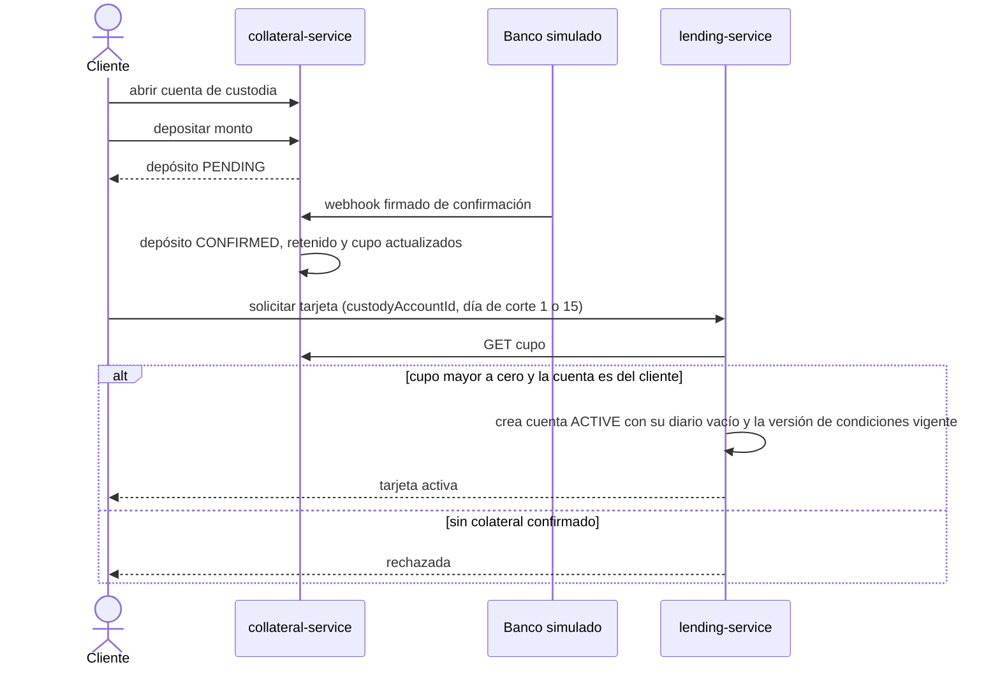
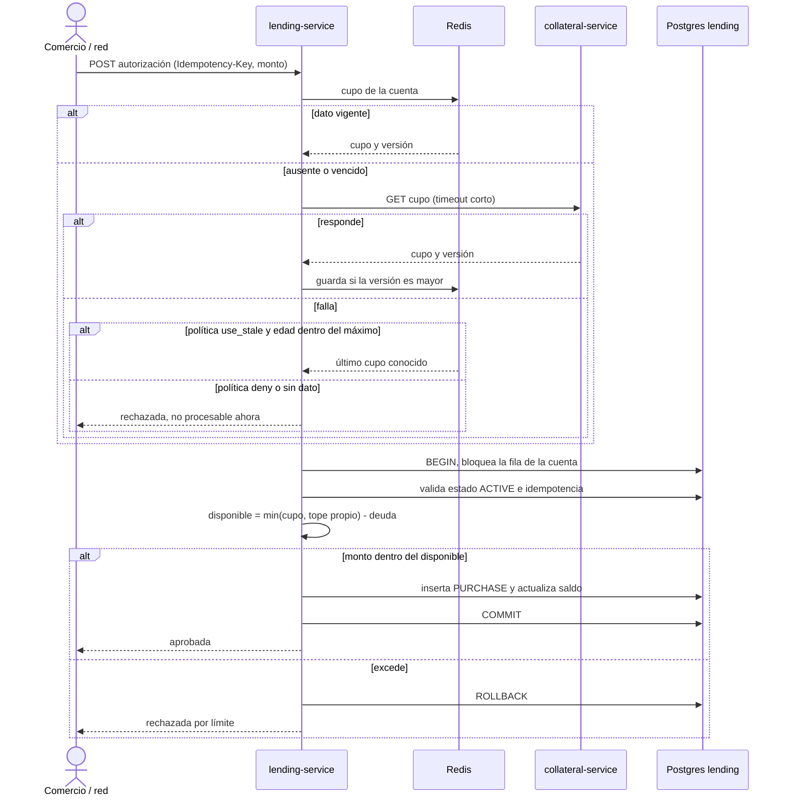
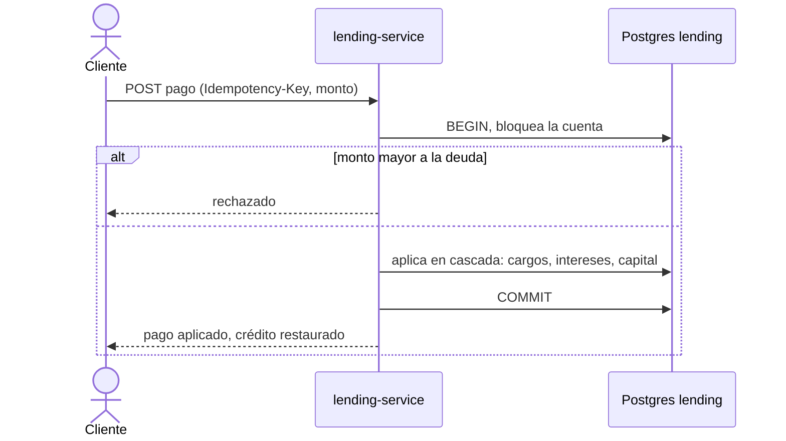
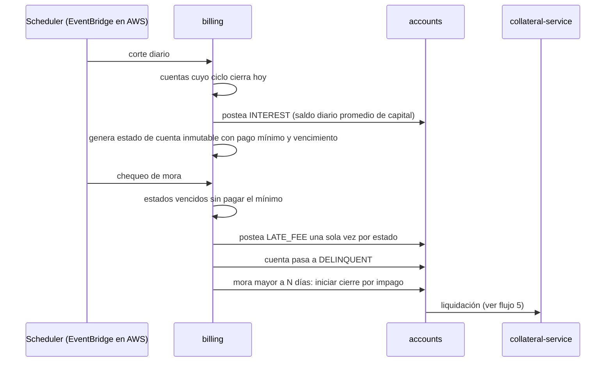
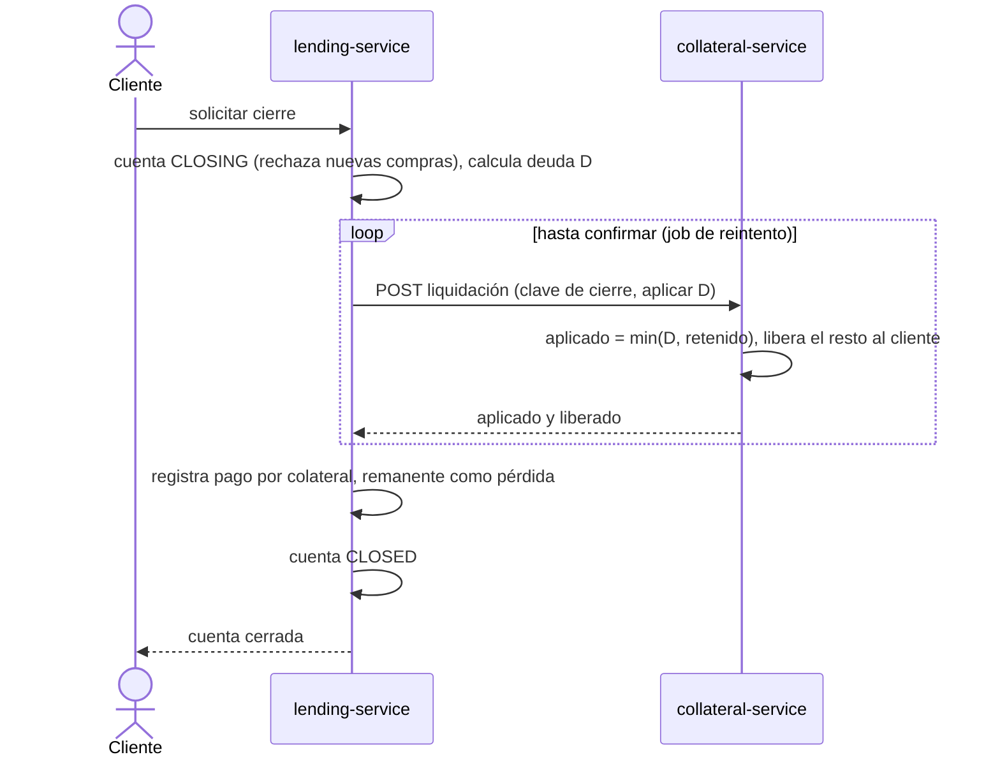
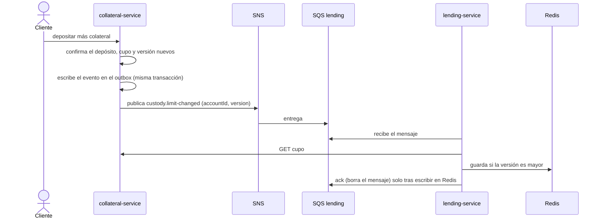
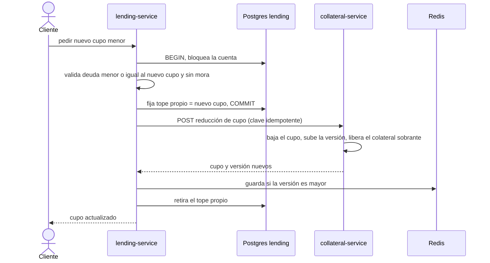

# Flujos principales

Los montos son enteros en centavos. Toda operación que mueve dinero exige `Idempotency-Key`.

## 1. Apertura: custodia, depósito y tarjeta

## 2. Autorización de una compra

La lectura de Redis y la consulta a custodia ocurren antes de abrir la transacción, nunca con la fila bloqueada.

## 3. Pago

## 4. Ciclo de facturación y mora

Cada paso es idempotente por clave única (cuenta y ciclo, estado y tipo), así que ejecutar el job dos veces no duplica nada.

## 5. Cierre y liquidación del colateral

La orden es idempotente por la clave de cierre. Si la llamada falla, la cuenta permanece en `CLOSING` y el job reintenta.

## 6. Cambio de cupo por depósito (aumento)

Si falla Redis o custodia, no hay ack: el mensaje reaparece tras el tiempo de visibilidad y, agotados los intentos, va a la DLQ con alerta. Un duplicado o un mensaje antiguo no hace daño porque solo se acepta una versión mayor. Si un evento se pierde, el TTL del cupo lo corrige en un máximo de 12 horas.

## 7. Reducción de cupo o retiro parcial

El tope propio se guarda en Postgres dentro de la misma transacción que valida la deuda, así ninguna compra puede superar el nuevo cupo mientras Redis aún tiene el anterior. Solo se retira después de escribir el valor nuevo en Redis. Si la llamada a custodia o la escritura fallan, el tope permanece y un job de reintento completa la operación con la misma clave idempotente.
